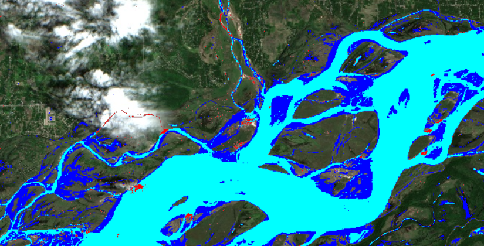

# 🌊 OptiSAR Rescue — Flood Extent Mapping Prototype

> Automated flood-mapping pipeline using satellite radar (SAR) and optical imagery to detect and quantify flood inundation in near real-time.


---

## 📌 Overview

This project implements an end-to-end flood detection pipeline that combines **Sentinel-1 SAR** (Synthetic Aperture Radar) and **Sentinel-2 optical** satellite imagery via the **Google Earth Engine** Python API to map flood extent over **Kaziranga National Park, Assam** — one of India's most flood-affected UNESCO World Heritage Sites.

The pipeline:
1. **Acquires** multi-sensor satellite data from the ESA Copernicus program
2. **Extracts** permanent water bodies using NDWI (Normalized Difference Water Index) from optical bands
3. **Segments** flood water from SAR backscatter (VV polarization < −15 dB)
4. **Isolates** new inundation by subtracting permanent water from total water detection
5. **Calculates** real-world flood area (~5 sq. km detected)
6. **Renders** multi-layer interactive geospatial overlays using Folium

---

## 🔬 Methodology

```
┌─────────────────────┐     ┌─────────────────────┐
│   Sentinel-2 (Opt)  │     │   Sentinel-1 (SAR)  │
│  B3 (Green), B8 (NIR)│     │    VV Polarization  │
└────────┬────────────┘     └────────┬────────────┘
         │                           │
    NDWI > 0                    VV < -15 dB
         │                           │
         ▼                           ▼
 ┌───────────────┐          ┌───────────────┐
 │ Optical Water │          │   SAR Water   │
 │   (Permanent) │          │   (All Water) │
 └───────┬───────┘          └───────┬───────┘
         │                          │
         └──────────┬───────────────┘
                    ▼
        ┌───────────────────┐
        │ Flood Inundation  │
        │ = SAR ∧ ¬Optical  │
        └───────────────────┘
                    │
                    ▼
         Area ≈ 5 sq. km
```

### Why SAR + Optical?

| Sensor | Strength | Limitation |
|--------|----------|------------|
| **Sentinel-2 (Optical)** | High spatial resolution, NDWI for water | Blocked by monsoon cloud cover |
| **Sentinel-1 (SAR)** | Penetrates clouds, works day/night | Cannot distinguish permanent water from flood |
| **Combined** | ✅ Cloud-proof flood detection with permanent water removal | — |

---

## 🗺️ Study Area

**Kaziranga National Park, Assam, India**
- 📍 Coordinates: 26.58°N, 93.17°E
- 📐 Buffer Region: 10 km radius (~314 sq. km analysis area)
- 📅 Observation Period: June – August 2024 (Indian Monsoon Season)
- 🦏 Significance: UNESCO World Heritage Site, home to 2/3 of the world's Indian one-horned rhinoceros — severely impacted by annual Brahmaputra flooding

---

## 📸 Output & Visualizations

### Geospatial Flood Inundation Overlay (Kaziranga AOI)

<p align="center">
  
</p>

### 🔍 Output Summary — What You Are Seeing

| Visual Layer | Color Indicator | What It Represents | Why It Matters |
|---|---|---|---|
| **Permanent River Channel** | 🟦 **Cyan / Light Blue** | Baseline river bodies and lakes extracted via **Sentinel-2 Optical (NDWI > 0)**. | Establishes normal water boundaries so normal water flow is never misclassified as a flood. |
| **Active Flood Inundation** | 🟦 **Dark Blue** | Terrain submerged by overflow, detected via **Sentinel-1 SAR Radar (VV < -15 dB)**. | Isolates newly drowned terrain and wildlife habitats (~5 sq. km) needing urgent rescue focus. |
| **Critical Boundary Margins** | 🔴 **Red Indicators** | High-risk flood fronts and active transition edges where water breaches land. | Pinpoints active spillover zones to help emergency teams prioritize evacuation routes. |
| **Monsoon Cloud Cover** | ☁️ **White Clouds (Top-Left)** | Natural storm cloud cover visible on the optical background layer. | **Proof of SAR capability:** Optical cameras are blinded by clouds, but radar penetrates right through them. |

---

### 💡 How It Works in Simple Terms (The 3-Step Logic)

1. **🛰️ Piercing Through the Clouds (Sentinel-1 SAR):**
   Monsoon floods come with heavy rain and thick storm clouds. Standard satellite cameras cannot see through clouds. **Sentinel-1 SAR** sends active radar pulses down to Earth:
   - Smooth water acts like a mirror, reflecting radar pulses away (appears as dark backscatter $< -15\text{ dB}$).
   - Rough land bounces radar back to the satellite (appears bright).
   - *Result:* Detects **all surface water** — 24/7, rain or shine, through dense monsoon clouds.

2. **🌊 Filtering Out Regular Rivers (Sentinel-2 Optical):**
   Just knowing where water is isn't enough — permanent rivers shouldn't trigger flood disaster alarms. We use pre-flood **Sentinel-2 optical imagery** and the Normalized Difference Water Index (NDWI) to map where water naturally flows year-round.

3. **🎯 Isolating the Disaster Extent:**
   $$\text{True Flood Inundation} = \text{Total Radar Water} - \text{Permanent Optical Water}$$
   Subtracting baseline water leaves strictly the **newly flooded ground (~5 sq. km)**, eliminating false alarms and providing disaster response teams with high-confidence geospatial coordinates.

---

## 🚀 Quick Start

### Prerequisites

- Python 3.10+
- Google Earth Engine account ([sign up](https://earthengine.google.com/))
- Authenticated via `earthengine authenticate`

### Installation

```bash
git clone https://github.com/Pratek1/OptiSAR-Rescue.git
cd OptiSAR-Rescue
pip install -r requirements.txt
```

### Run the Notebook

```bash
jupyter notebook notebooks/flood_extent_mapping.ipynb
```

---

## 📂 Project Structure

```
OptiSAR-Rescue/
├── assets/
│   └── flood_extent_output.png      # Output visualization preview
├── notebooks/
│   └── flood_extent_mapping.ipynb   # Main analysis notebook
├── src/
│   └── flood_detector.py            # Standalone flood detection script
├── .gitignore
├── requirements.txt
├── LICENSE
└── README.md
```

---

## 🛠️ Tech Stack

| Technology | Purpose |
|-----------|----------|
| **Python 3** | Core language |
| **Google Earth Engine** | Planetary-scale geospatial analysis |
| **Sentinel-1 (C-SAR)** | Radar backscatter for water detection |
| **Sentinel-2 (MSI)** | Optical multispectral imagery |
| **Folium** | Interactive map visualization |
| **NumPy** | Numerical operations |

---

## 📊 Key Results

- **Flood extent detected:** ~5 sq. km within the Kaziranga buffer region
- **Observation period:** June – August 2024 (peak monsoon)
- **Output layers:** 4-layer interactive Folium map (True Color, Optical Water, SAR Water, Flood Inundation)

---

## 📄 License

This project is licensed under the MIT License — see the [LICENSE](LICENSE) file for details.

---

## 🙋 Author

**Prateek Patil**  
[GitHub](https://github.com/Pratek1)
